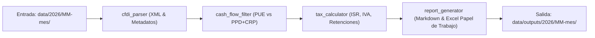
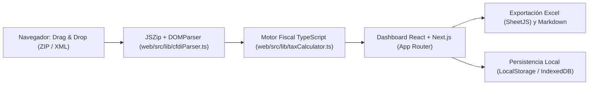

# 01 — Arquitectura del Sistema (`sat-fiscal-toolkit`)

## 🏛️ Visión General

`sat-fiscal-toolkit` está diseñado como un pipeline modular de procesamiento contable y fiscal en Python para personas físicas (Servicios Profesionales, Actividad Empresarial y RESICO).

## 🧩 Componentes Principales (`src/`)

1. **`cfdi_parser.py`**:
   - Lectura rápida de XMLs mediante `lxml` / `xml.etree`.
   - Extracción de atributos de Comprobante (UUID, Fecha, Total, SubTotal, MetodoPago, FormaPago).
   - Extracción de Conceptos, ClaveProdServ, ClaveUnidad.
   - Extracción de Impuestos Trasladados (IVA) y Retenidos (ISR, IVA).
   - Extracción de Complementos (CRP 2.0 / Pagos20).

2. **`cash_flow_filter.py`**:
   - Clasificación por criterio de flujo de efectivo según LISR y LIVA.
   - Asociación de complementos de pago con su CFDI origen mediante UUID relacionado.

3. **`tax_calculator.py`**:
   - Base gravable para ISR provisional.
   - Base acreditable para IVA y cálculo de IVA neto a pagar o saldo a favor.
   - Conciliación de retenciones realizadas por personas morales.

4. **`excel_generator.py` y `markdown_generator.py`**:
   - Generación de papeles de trabajo estructurados en `.xlsx` con pestañas mensuales:
     - Ingresos PUE y Cobrados
     - Egresos Deducibles
     - Determinación ISR
     - Determinación IVA
   - Resúmenes ejecutivos en Markdown optimizados para auditoría rápida con LLMs (NotebookLM, Gemini).

---

## 🌐 Aplicación Web Client-Side (`web/`) — GitHub Pages

Para usuarios interactivos y auditoría en navegador con privacidad absoluta:

- **Framework:** Next.js (Static Export `output: 'export'`) alojado en GitHub Pages.
- **Seguridad y Privacidad:** Procesamiento 100% *Local-First* en el navegador del cliente. Ninguna factura ni dato fiscal viaja por internet.
- **Despliegue Continuo:** GitHub Actions vía `.github/workflows/deploy-pages.yml` compilando `web/` hacia `web/out/`.

---

## 🖥️ Automatización de Navegador y Puente Persistente CDP

Para tareas de verificación visual, pruebas de comportamiento end-to-end y sincronización con consolas web (Google Search Console, Bing Webmaster, Analytics):

- **Arquitectura de Sesión Persistente:** Uso mandatorio del puente `chrome_devtools_bridge.mjs` conectado a `chrome-devtools-mcp`.
- **Detección Dinámica:** Lectura de `DevToolsActivePort` para vincular dinámicamente el socket activo del navegador.
- **Prevención de Diálogos Recurrentes:** Se mantiene una sola conexión WebSocket viva por sesión de trabajo, garantizando que el usuario solo apruebe la depuración remota una única vez por sesión.
